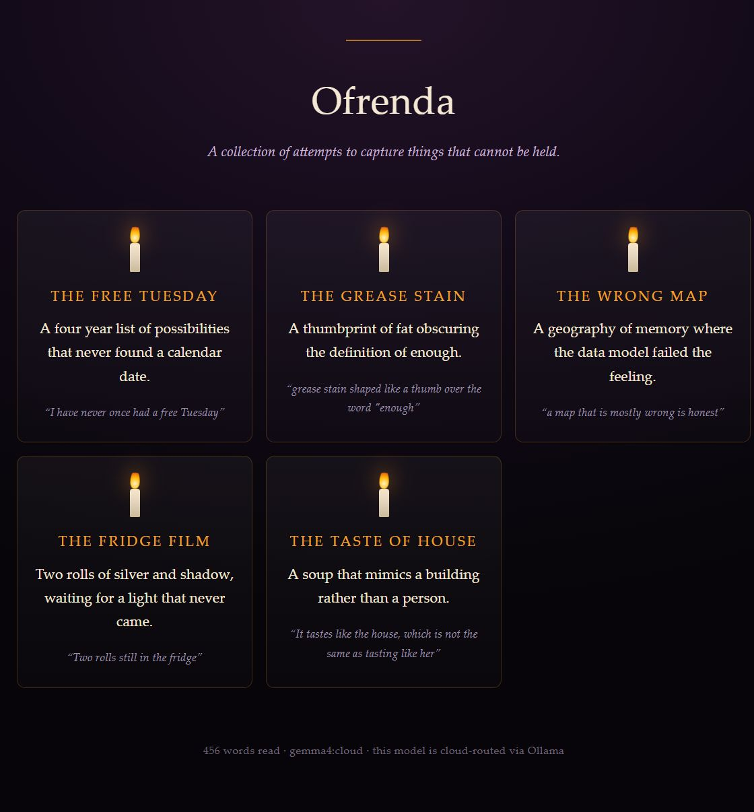

# lantern

**An ofrenda for the words you forgot you wrote.**

Point `lantern` at a folder of old notes. An open-weight model reads them, finds
the ghosts still living in them — motifs you kept circling, ideas you abandoned
but never quite buried — writes an epitaph for each one, and lights a candle for
it on an HTML altar.



Everything is one Python file with no dependencies. No account, no upload, no
build step. The altar is a single self-contained HTML file that will still open
in ten years.

## Run it

```bash
ollama serve                       # any model you already have works
python lantern.py notes/           # a folder, or a single .md/.txt file
```

That writes `ofrenda.html`. Open it in a browser.

```bash
python lantern.py notes/ --model gemma3:4b --ghosts 5 -o ofrenda.html
```

| Flag | Meaning |
| --- | --- |
| `--model` | any Ollama model tag (default: `$LANTERN_MODEL`, else `gemma3:4b`) |
| `--ghosts` | how many ghosts to raise (default: 5) |
| `-o` | output path (default: `ofrenda.html`) |

There is no API key. `OLLAMA_HOST` points it at another machine if you must.

## What it does with your words

1. **Gather** — reads `.md` / `.txt` files recursively and flattens them, capped at 6000 characters.
2. **Conjure** — one request to `/api/generate` with `format: "json"`. The model is told to copy a phrase near-verbatim for each ghost, so you can trace every epitaph back to a real line of your own writing.
3. **Render** — escapes everything, then writes one HTML file with the candles in CSS.

The prompt asks for specific ghosts, not wisdom. That is the whole trick: a
model asked for insight produces greeting cards, but a model asked *which
sentence does this person keep returning to* becomes an archivist.

## Honesty about where inference runs

`lantern` talks to whatever Ollama serves. Check your model tag: `gemma4:cloud`
and other `:cloud` tags are routed off your machine by Ollama, and the altar's
footer says so. A pulled local tag (`gemma3:4b`, `qwen3:8b`, `mistral`) runs
entirely on your own hardware — that is the configuration this project was
built for, and the one where the footer reads *local inference, nothing left
this machine*.

The tool makes no network calls other than to `OLLAMA_HOST`.

## Why this exists

Journal apps are built for the present tense. They want you to add today's
entry, keep the streak, export the archive to a dashboard.

Nobody builds a tool for the *end* of writing — for the folder from four years
ago that you cannot bear to reread and cannot bring yourself to delete. Under
Día de los Muertos logic, those notes do not need archiving. They need a
candle, a name, and one honest sentence, and then they can be left alone.

## License

MIT
